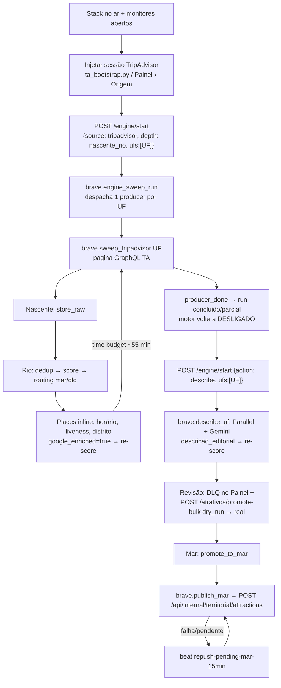

# Runbook de execução do Brave (produção no Mac)

> Como rodar o Brave de verdade: preparação, subida, execução por UF, monitores, falhas,
> backup e passagem para o DEV. Regra de negócio e camadas: `docs/FLUXO-BRAVE.md`.
> Escrito em 2026-10-19, contra o código da `main` (Alembic head `0020`).

## 1. Onde e como roda

- **Máquina**: este MacBook, stack em Docker (`docker compose`). A VPS DEV não tem folga para o Brave.
- **Serviços**: postgres (pgvector) · redis · migrate (one-shot) · api `:8000` · worker · beat · dashboard `:3000/painel`.
- **Destino do Mar**: norteia-api local na ddev (`http://norteia-api.ddev.site`, branch `develop`).
  No fim, o banco da API é exportado e restaurado no DEV (seção 10).
- **Lane ativa**: TripAdvisor (`source.tripadvisor.enabled=true`). A lane `default` (Places/Mtur) segue desligada.

Três coisas **não** acontecem sozinhas. Elas determinam a ordem da execução:

1. **O sweep para no Rio.** Ele roteia cada atrativo para `mar` ou `dlq` pelo score, mas nunca chama `promote_to_mar`.
   O Mar só recebe um registro por promoção humana (DLQ validar, card, ou `promote-bulk`).
2. **Descrição editorial é outro run** (`action: "describe"`), depois do sweep, só para os registros com `google_enriched`.
3. **O push para a API só acontece depois da promoção.** A task `brave.publish_mar` dispara logo após a promoção. O beat `repush-pending-mar-15min` reenvia o que ficou pendente.

## 2. Fluxo de execução de uma UF



| Etapa | Task / endpoint | Fim da etapa | Onde ver |
|---|---|---|---|
| Sessão TA | `POST /api/v1/tripadvisor/session` | TTL > 0, `needs_bootstrap` ausente | monitor `ta-session` |
| Sweep | `brave.engine_sweep_run` → `brave.sweep_tripadvisor` | `producers_inflight=0` **e** `last_run_ended=1`; `runs_history.status` = `concluido` ou `parcial` | `engine`, `logs` (`ta_atrativos_producer_done`) |
| Nascente/Rio | `store_raw` → `process_nascente_record` | contadores estáveis | `funnel` |
| Places | `PlacesEnrichmentAgent` (inline no sweep) | `places_enriched` ≈ `rio` | `funnel`, `cost` |
| Descrição | `brave.describe_uf` (blocos de 25, 5 em paralelo) | `described` para de crescer, run `descricao` encerrado | `funnel`, `cost`, `logs` (`describe_uf_*`) |
| Promoção | `POST /api/v1/atrativos/promote-bulk` | `promoted` / `held` / `failed` na resposta | `funnel` (mar active) |
| Push | `brave.publish_mar` (+ repush a cada 15 min) | `mar pending=0 REJECTED=0` | `funnel`, `api-ingest` |

`ufs_done=1` só quer dizer que a UF foi **despachada**. O run termina quando `producers_inflight` chega a 0.

## 3. Pré-voo (antes de cada execução)

```bash
# 0. Mac sem dormir durante o run (fecha junto com o terminal)
caffeinate -dimsu &

# 1. API receptora no ar (develop) e token válido
cd ../norteia-api && ddev start && git branch --show-current   # → develop
cd -
scripts/monitors/api-ingest.sh   # deve mostrar "health=200 ingest_probe=422 (ok)"; Ctrl-C

# 2. Stack
docker compose up -d
docker compose ps -a            # migrate Exited (0); demais Up
```

Checklist:

- [ ] **Docker Desktop** com pelo menos 6 GB de RAM; o worker roda 8 processos.
- [ ] **norteia-api rápida**: `DEBUGBAR_ENABLED=false` no `.env` da norteia-api.
      Com o Debugbar ligado (padrão com `APP_DEBUG=true`), o `/api/v1/health` levava 1–26 s.
      O Brave usa timeout de 3 s, marcava a API como `unreachable` e bloqueava o push.
      Com ele desligado, a latência cai para menos de 1 s. Se puder, pare outros projetos ddev durante o run.
- [ ] **VM do Docker com folga.** Em 2026-10-19, com 8 GB dos 16 GB do Mac e outro projeto ddev ativo, a VM chegou a
      load 11,9 em 8 CPUs, 536 MB livres e 1,4 GB de swap. O health da ddev oscilou entre 0,2 e 10 s, e o push ficou
      bloqueado como `norteia_api_down` (o repush de 15 min recupera, mas atrasa).
      Recomendado: Docker Desktop › Resources com 10–12 GB. Mudar isso reinicia o Docker e derruba **todos** os containers,
      inclusive os de outros projetos. Faça numa janela combinada.
- [ ] **Token `brave-ingest` válido.** O Sanctum expira em 30 dias (`sanctum.expiration=43200`).
      Emitido em 2026-10-19, vence em **~2026-11-18**. Para renovar:
      ```bash
      cd ../norteia-api && ddev exec php artisan tinker --execute='echo \App\Models\User::find(1)->createToken("brave-ingest", ["territorial:ingest"])->plainTextToken;'
      ```
      Cole o valor **entre aspas** em `BRAVE_NORTEIA_API_SERVICE_TOKEN`; sem aspas, o `|` quebra `set -a; . ./.env`.
      Depois rode `docker compose up -d api worker beat` para recriar com o env novo.
- [ ] **`.env`** com `RUN_REAL_EXTERNALS=true` e as chaves: `BRAVE_LLM_OPENROUTER_API_KEY`, `BRAVE_LLM_ANTHROPIC_API_KEY`,
      `BRAVE_LLM_GEMINI_API_KEY`, `BRAVE_PLACES_API_KEY`, `PARALLEL_API_KEY`, `BRAVE_DASHBOARD_BEARER_TOKEN`
      (igual ao de `dashboard/.env.local`), `BRAVE_STEWARD_SECRET`, `BRAVE_WEBHOOK_SECRET`, `BRAVE_NORTEIA_API_URL`/`_SERVICE_TOKEN`.
      Opcionais, sem uso hoje: `BRAVE_LLM_DEEPSEEK_API_KEY`, `TAVILY_API_KEY`, `SERPER_API_KEY` (POCs), WhatsApp (`BRAVE_WA_*`, lane parada).
- [ ] **Config efetiva** (`GET /api/v1/config` ou Painel › Config): `places_enrichment_enabled=true`,
      `description_enrichment_enabled=true`, `atrativo_description_cascade_enabled=true`, `atrativo_description_batch_enabled=false`.
      Essas flags vivem em `config_settings`, não no `.env`.
- [ ] **Referências populadas**: `municipios=5571`, `distritos=10751`, `uf_geoids=27`.
- [ ] **Monitores abertos** (seção 5).

## 4. Execução (exemplo: SE)

```bash
set -a; . ./.env; set +a
H="Authorization: Bearer $BRAVE_DASHBOARD_BEARER_TOKEN"; API=http://localhost:8000

# 4.1 Sessão TripAdvisor. No Chrome logado: lista de atrações da UF › DevTools › Network (limpar) ›
#     clicar em PRÓXIMA PÁGINA › Cmd+F "pagee" › o POST /data/graphql/ids cujo item tem
#     request.routeParameters.pagee › Copy as cURL (bash) › salvar em scripts/single_attraction/ta_session.curl
#     (o lote da carga inicial da página só traz telemetria; o canary falha com ele)
.venv/bin/python scripts/ta_bootstrap.py --curl scripts/single_attraction/ta_session.curl \
  --endpoint $API --bearer "$BRAVE_DASHBOARD_BEARER_TOKEN"

# 4.2 Sweep da UF (sem teto; para testar com teto, acrescente "max_atrativos_per_uf": 20)
curl -sX POST $API/api/v1/engine/start -H "$H" -H 'content-type: application/json' \
  -d '{"source":"tripadvisor","depth":"nascente_rio","ufs":["SE"]}'

# 4.3 Depois que o run encerrar (motor DESLIGADO): descrições
curl -sX POST $API/api/v1/engine/start -H "$H" -H 'content-type: application/json' \
  -d '{"action":"describe","ufs":["SE"]}'

# 4.4 Promoção. Primeiro dry-run, depois real (limite 200 por chamada; repita enquanto remaining>0)
curl -sX POST $API/api/v1/atrativos/promote-bulk -H "$H" -H 'content-type: application/json' \
  -d '{"uf":"SE","min_score":65,"require_description":true,"limit":200,"dry_run":true}'
curl -sX POST $API/api/v1/atrativos/promote-bulk -H "$H" -H 'content-type: application/json' \
  -d '{"uf":"SE","min_score":65,"require_description":true,"limit":200,"dry_run":false}'

# 4.5 Push pendente/rejeitado: o beat reenvia a cada 15 min; para forçar:
curl -sX POST $API/api/v1/mar/repush -H "$H"
```

Notas:

- `promote-bulk` e as edições de card exigem o motor **PAUSADO ou DESLIGADO**; com ele LIGADO voltam 423.
- O sweep TA re-enfileira a si mesmo a cada ~55 min (time budget) e preserva o `run_id`, então UFs grandes atravessam várias tasks.
- Parar com segurança: `POST /api/v1/engine/stop` (drena a UF em voo). Pausar: `POST /api/v1/engine/mode {"mode":"PAUSADO"}`.
- Nunca use `docker compose kill worker` com sweep rodando, porque perde a task `acks_late` até o `visibility_timeout`.
  `docker compose stop worker` espera até 65 min.

## 5. Monitores

Sete scripts em `scripts/monitors/`. Cada um imprime **uma linha por mudança** (`HH:MM:SS [tag] mensagem`).
Servem tanto num painel tmux quanto como `Monitor` do Claude Code (cada linha vira uma notificação).

```bash
MONITOR_UF=SE scripts/monitors/tmux.sh     # abre os 7 em painéis; logs em .run/monitors/*.log
tmux kill-session -t brave-mon              # encerra
```

| Monitor | Fonte | O que mostra | Sinal de alerta |
|---|---|---|---|
| `engine.sh` | `GET /engine/status`, Redis `brave:engine:*`, `runs_history` | state/mode/UF/sync, producers inflight/failed, `pause_reason`, `beat_errors`, linha do run | `PAUSE_REASON`, `mode=DESLIGADO` no meio do sweep, `failed>0`, `status=parcial/falha` |
| `funnel.sh` | Postgres | nascente → rio (in_progress/mar/dlq/descarte) → places_enriched → described → Mar (pushed/pending/REJECTED), motivos de DLQ, poison | `REJECTED>0`, `poison_quarantine` subindo, `in_progress` parado |
| `logs.sh` | `docker compose logs -f worker beat api` | eventos de fronteira de etapa e de falha (sem o ruído por registro) | `sweep_tripadvisor_session_fail_fast`, `task_daily_budget`, `task_provider_balance`, `publish_rejected`, `norteia_api_down`, `Traceback`, `WorkerLostError` |
| `stack.sh` | Docker + `/health` + `/workers` + `LLEN celery` | estado/health/restarts dos containers, workers Celery, profundidade da fila | serviço `NOT RUNNING`, `restarts` subindo, `workers=0`, `api health: DOWN` |
| `ta-session.sh` | Redis (só TTL, nunca o conteúdo) | sessão viva/expirando/ausente, `needs_bootstrap`, falhas do keepalive | `ABSENT`, `needs_bootstrap=1`, `EXPIRING` |
| `cost.sh` | Redis `brave:cost:*`, `/cost`, `llm_generations` | gasto LLM+busca do dia (UTC), Places do dia e crédito total por chave | 50/80/100% de um teto |
| `api-ingest.sh` | ddev norteia-api | health + probe de ingestão, contagem de destinations/attractions, `ERROR` novos do `laravel.log` | `TOKEN EXPIRED/WRONG`, `API DOWN?`, `laravel: ...ERROR` |

Variáveis: `MONITOR_INTERVAL` (padrão 15 s; 30 s no api-ingest), `MONITOR_UF` (filtra o funnel), `COST_STEP` (US$ 0,25).
O Painel (`http://localhost:3000/painel`) continua sendo a visão humana principal: Kanban, DLQ, Varreduras e Custos.

## 6. Quando o run acabou

- **Sweep**: monitor `engine` mostra `producers inflight=0 … last_run_ended=1`, e `runs_history` aparece com `ended_at` e `status=concluido`.
  `parcial` significa que o run parou, pausou ou teve producer falho. Veja o `logs` para saber o motivo.
- **Describe**: `described` estável no `funnel` e um novo `runs_history` com `source=descricao` encerrado.
- **Publicação**: `mar pending=0 REJECTED=0` no `funnel` e `attractions` na API subindo o mesmo tanto no `api-ingest`.

## 7. Falhas comuns

| Sintoma | Causa | Ação |
|---|---|---|
| `sweep_tripadvisor_session_fail_fast`, motor DESLIGADO | TA 403/captcha: sessão morreu | Novo cURL (4.1) e `engine/start` de novo. Os já ingeridos são pulados |
| `PersistedQueryNotFound` / `ta_keepalive_error SourceSchemaError` / inject devolve 503 `canary_unverified` | O TA rotacionou o qid da listagem (aconteceu em 2026-10-19: `79aaeeb847e55e58` → `0e26761de5110a17`) | Capturar como em 4.1, pegar o `preRegisteredQueryId` do item com `routeParameters.pagee`, pôr `BRAVE_TA_QUERY_ID_OVERRIDE={"listing":"<qid>"}` no `.env` e rodar `docker compose up -d api worker beat`. Depois atualizar `_LISTING_QID_GQL` em `brave/domains/tripadvisor/client.py` |
| `sweep_tripadvisor_rate_limited` | 429 do TA | Nada. A task se re-agenda com `Retry-After` (até 5x sem progresso) |
| `PAUSE_REASON {reason: daily_budget}` | cost guard do dia (`BRAVE_LLM_USD_DAILY_BUDGET`=50 ou `PLACES_DAILY_USD_CAP`) | Espera a virada do dia UTC (o beat retoma) ou sobe o teto conscientemente |
| `PAUSE_REASON {reason: provider_balance}` | crédito da chave Places acabou (US$ 300) ou saldo do provedor | Trocar `BRAVE_PLACES_API_KEY`, `docker compose up -d api worker beat`, retomar |
| `publish_rejected status=422` | payload recusado pela API | `funnel` mostra o `push_error`; corrigir o contrato. Repush só depois de 24 h ou via `/mar/repush` |
| `norteia_api_down` / probe 401 | ddev parada ou token vencido | `ddev start` / renovar token (seção 3). O repush recupera sozinho |
| `poison_quarantine` subindo | card com erro de parsing/validação | `GET /api/v1/failures`. Não bloqueia o run |
| `describe` volta 409 | flags de descrição ou chave de busca | Conferir config (seção 3) e `PARALLEL_API_KEY` |
| worker `restarts` subindo | OOM ou crash | `docker compose logs worker`, memória do Docker Desktop |

## 8. Custos de referência

- Places (inline no sweep): Text Search + Place Details, cerca de US$ 0,06 por atrativo. Teto de US$ 300 por chave e por dia.
- Descrição (cascata Parallel + Gemini Flex): cerca de US$ 0,02 por atrativo.
- O contador diário LLM+busca é **compartilhado** e fica preservado no reset (`brave:cost:daily:<UTC>`).

## 9. Backup e restauração do Brave

Backups em `backups/` (gitignored):

| Arquivo | Conteúdo |
|---|---|
| `brave-pre-prod-reset-20261019-1403.dump` | estado antes da limpeza de produção (431 Rio de testes, Alembic 0017) |
| `brave-clean-prod-20261019-1405.dump` | **base limpa de produção**: Alembic 0020, referências, Cadastur, `atrativo_buscas`, `config_settings` (motor DESLIGADO). Restore testado |

```bash
# novo backup
docker compose exec -T postgres pg_dump -U brave -d norteia_brave -Fc > backups/brave-$(date +%Y%m%d-%H%M).dump

# restaurar (pare api/worker/beat antes)
docker compose stop api worker beat
docker compose exec -T postgres psql -U brave -d postgres -c 'drop database norteia_brave with (force)' -c 'create database norteia_brave'
docker compose exec -T postgres pg_restore -U brave -d norteia_brave --no-owner < backups/brave-clean-prod-20261019-1405.dump
docker compose exec -T redis redis-cli --scan --pattern 'brave:engine:*' | xargs docker compose exec -T redis redis-cli del
docker compose up -d
```

Para limpar sem restaurar, use a skill `reset-brave-db`
(`--keep config_settings` preserva a config do operador; as tabelas de referência e `atrativo_buscas` são sempre preservadas).

## 10. Pós-execução: API local → DEV VPS

O destino final do run é a norteia-api da ddev. Para levar ao DEV (`dev-api.norteia.app.br`, MySQL 8.4 em `dev-norteia-mysql`):

```bash
# 1. dump da ddev (só o necessário; um dump completo sobrescreve usuários/billing do DEV)
cd ../norteia-api
ddev export-db --gzip --file=../norteia-api-territorial-$(date +%Y%m%d).sql.gz   # completo
#    ou só as tabelas territoriais:
ddev exec mysqldump db destinations destination_aliases destination_tourism_segment \
  tourist_region_destination attractions attraction_place_details attraction_tourism_segment \
  | gzip > ../norteia-api-territorial-$(date +%Y%m%d).sql.gz

# 2. backup do DEV antes de restaurar, depois enviar e restaurar
ssh root@168.231.89.232 'docker exec dev-norteia-mysql sh -c "mysqldump -uroot -p\$MYSQL_ROOT_PASSWORD \$MYSQL_DATABASE" | gzip > /opt/norteia-dev/backups/pre-brave-restore-$(date +%Y%m%d).sql.gz'
scp ../norteia-api-territorial-*.sql.gz root@168.231.89.232:/opt/norteia-dev/backups/
ssh root@168.231.89.232 'gunzip -c /opt/norteia-dev/backups/norteia-api-territorial-*.sql.gz | docker exec -i dev-norteia-mysql sh -c "mysql -uroot -p\$MYSQL_ROOT_PASSWORD \$MYSQL_DATABASE"'
```

Antes de restaurar, confirme as migrations: o DEV precisa estar na mesma versão de schema que a ddev (`php artisan migrate:status` nos dois).
**Atenção**: a ddev já tinha 25 destinations e 43 attractions de testes antigos *antes* deste run.
Limpe essas tabelas na ddev antes do run de produção, ou filtre na exportação.

## 11. Encerrar

```bash
curl -sX POST localhost:8000/api/v1/engine/stop -H "$H"   # se algo estiver rodando
docker compose stop                                         # mantém dados
tmux kill-session -t brave-mon; kill %caffeinate 2>/dev/null
```
